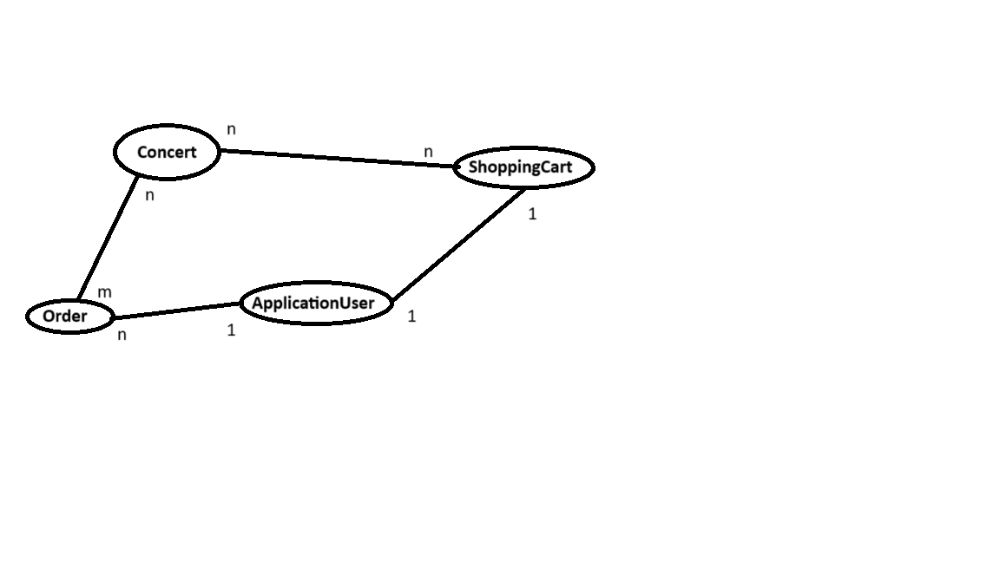

# ConcertTickets

An online ticket shop for concerts built with **ASP.NET Core** and **Onion (layered) Architecture**. Customers browse events, add tickets to a cart, pay with Stripe and get an email confirmation. A separate admin application manages orders and users through the main app's API.



## Features

**Customers**
- Register and sign in with ASP.NET Core Identity
- Browse available concerts and view concert details
- Add tickets to a shopping cart and place an order
- Pay for orders with **Stripe**
- Receive an order confirmation email (sent by a background service through MailKit)

**Admins**
- Full CRUD for concerts
- Browse all orders and view order details
- Export all orders to **Excel** (ClosedXML)
- Generate an invoice document for any order (GemBox.Document)
- Bulk-import users from an Excel file (ExcelDataReader), see `users.xlsx` for the sample format

## Architecture

The solution follows Onion Architecture: dependencies point inward, and each layer only knows about the layers beneath it.

```
EShop.Domain           Entities, DTOs and settings. No dependencies.
EShop.Repository       EF Core DbContext and repositories (generic + specialised)
EShop.Service          Business logic behind interfaces (cart, orders, concerts, email)
EShop.Web              Customer-facing MVC app and the REST API used by the admin app
EShopAdminApplication  Standalone admin app that talks to EShop.Web over HTTP
```

Key design choices:
- **Dependency injection everywhere.** Controllers depend on service interfaces and services depend on repository interfaces, so every layer can be swapped or mocked.
- **Generic repository** (`IRepository<T>`) for common data access, with dedicated repositories for orders and users where queries need eager loading.
- **Background email processing.** Confirmation emails are queued in the database and sent by a hosted service (`ConsumeScopedHostedService` → `BackgroundEmailSender`), so checkout never waits on SMTP.
- **Separate admin application.** Admin tooling runs as its own app and uses the main app's API, which keeps admin-only dependencies out of the customer app.

## Tech stack

| Area | Technology |
|---|---|
| Framework | ASP.NET Core 3.1, MVC |
| Data | Entity Framework Core, SQL Server |
| Auth | ASP.NET Core Identity, role-based authorization |
| Payments | Stripe |
| Email | MailKit (SMTP), background hosted service |
| Documents | ClosedXML, ExcelDataReader, GemBox.Document |
| Logging | NLog |

## Getting started

**Prerequisites:** .NET Core 3.1 SDK, SQL Server (LocalDB works) and a Stripe test account.

1. Clone the repository.
2. In `EShop.Web/appsettings.json`, set:
   - `ConnectionStrings:DefaultConnection` to your SQL Server
   - `StripeSettings` to your Stripe **test** keys
   - `EmailSettings` to your SMTP server and credentials
3. Apply the database migrations:
   ```bash
   cd EShop.Web
   dotnet ef database update
   ```
4. Run the customer app:
   ```bash
   dotnet run --project EShop.Web
   ```
5. Optionally run the admin app. It calls the `api/Admin` endpoints of `EShop.Web`, expected at `https://localhost:44332`:
   ```bash
   dotnet run --project EShopAdminApplication/EShopAdminApplication
   ```

Keep real keys out of source control. Use [user secrets](https://learn.microsoft.com/aspnet/core/security/app-secrets) or environment variables instead.

## Background

Built as a project for the *Integrated Systems* course at the Faculty of Computer Science and Engineering (FINKI), Ss. Cyril and Methodius University in Skopje.
